# Quick Start: Autonomous Mission with Pixhawk Cube Black and Yahboom MicroROS V2 (No Raspberry Pi)

**Experiment date:** 1 November 2026  
**Platform:** Mac + UTM Ubuntu 22.04 ARM64, ROS 2 Humble, Yahboom MicroROS V2 two-motor chassis, Pixhawk Cube Black running ArduRover 4.7.2, RFD868x telemetry, ArduDeck.  
**Result:** A mission was uploaded and AUTO mode generated real differential-wheel motor commands. The robot responded with its wheels suspended; **field navigation and confirmed waypoint arrival remain untested**.

> **Safety and scope:** This is a reconstruction of a supervised bench experiment, not a ready-to-deploy outdoor autonomy procedure. The experiment used bypassed pre-arm checks and a temporarily disabled geofence. The ESP32/Yahboom onboard motor timeout on Wi-Fi loss has not been verified. Before allowing ground contact, restore relevant arming checks, configure a site-appropriate geofence, verify emergency motor-power cutoff and a local watchdog, and carry out low-speed staged testing in a clear, controlled area. Never use the experimental bypass settings as a normal field configuration.

## 1. What makes this setup different?

The Cube Black performs ArduRover navigation, but **its PWM motor outputs are not wired to the Yahboom motor controller**. A Python bridge in the Mac-hosted Ubuntu VM reads the Pixhawk's `SERVO_OUTPUT_RAW` MAVLink telemetry and translates the left/right outputs into ROS 2 `/cmd_vel` commands. The Yahboom controller receives those commands via Wi-Fi and drives its two existing motors. **No additional PWM/ESC/motor-control cable was installed between the Pixhawk and the Yahboom controller.**

There **is** an existing USB power connection from the Yahboom controller to the Cube Black (as used in this experiment), plus the Here2 GNSS and RFD868x telemetry cables connected directly to the Cube Black; “no additional wiring” refers only to the *motor-control interface*. A USB connection may also carry data depending on the device, but it is **not** used here to transport motor commands.

```text
ArduDeck on Mac   <-- UDP :14550 -- MAVProxy on UTM Ubuntu
                                         |
                                         | /dev/ttyUSB0 57600
                                      RFD868x radio  ~~~  RFD868x radio
                                                              |
                                                        Cube Black
                                                Here2 GPS1; radio TELEM1
                                                    ArduRover AUTO
                                                    SERVO1/3 PWM
                                                              |
                                         MAVProxy receives telemetry by radio
                                         |
                               localhost UDP 14551
                                         |
                         mavlink_ros2_bridge_motion.py
                                         |
                          ROS 2 Humble /cmd_vel, domain 40
                                         |
                            micro-ROS agent UDP 8090
                                         |
                                        Wi-Fi
                                         |
                           Yahboom MicroROS V2 controller
                                         |
                            Existing two motor connections
```


## 2. Equipment and one-time prerequisites

- Mac with the **preconfigured UTM Ubuntu 22.04 ARM64 VM**, ROS 2 Humble, Yahboom workspaces and Python scripts already installed. This guide starts from the *working adapted image*, not from a clean OS installation.
- Yahboom MicroROS V2 two-motor controller configured to connect over Wi-Fi to the VM's micro-ROS agent at **`192.168.1.52:8090`**, with **`ROS_DOMAIN_ID=40`** for the ROS 2 side (and compatible firmware settings).
- Cube Black powered from the robot controller's USB power connection **as physically verified in this setup**. Make sure the available USB power meets the controller's requirements; do not assume every USB port can adequately power a Cube Black and its peripherals.
- Here2 GPS plugged into **GPS1** on Cube Black; RFD868x vehicle radio into **TELEM1**; other RFD868x radio connected via USB to the Mac.
- USB joystick receiver/dongle connected to the Mac (if using `JoystickControl`), recognized inside UTM.
- ArduDeck installed on the Mac and listening for UDP MAVLink on **14550**.
- Working `~/mavlink_ros2_bridge_motion.py` on Ubuntu with AUTO explicitly authorized, freshness and arming safeguards retained, and `geometry_msgs/msg/Twist` publishing to `/cmd_vel`.

### Relevant verified/observed parameters

| Setting | Value in the experiment | Notes |
|---|---|---|
| ArduPilot firmware | ArduRover 4.7.2 | Cube Black |
| `SERVO1_FUNCTION` / `SERVO3_FUNCTION` | `73` / `74` | Left/right skid-steering outputs |
| `RCMAP_ROLL` / `RCMAP_THROTTLE` | `1` / `3` | MAVLink RC steering/throttle inputs |
| `RC3_TRIM` | `1500` | Neutral, verify calibration |
| `MAV_GCS_SYSID` | `254` | MAVProxy uses `--source-system=254` |
| `RC_OVERRIDE_TIME` | `3` s | RC override expiry |
| `RC_OPTIONS` | `32` | Experimental current value |
| `FS_GCS_ENABLE` / `FS_ACTION` | `1` / `2` | GCS failsafe and HOLD action in previous checks |
| `FS_TIMEOUT` | `1.5` s | Previously observed |
| `FENCE_ENABLE` | `1`, then `0` for bench testing | **Do not carry this bench bypass into the field** |
| `FENCE_ACTION` / `FENCE_TYPE` | `1` / `6` | Prior polygon/circle geofence behavior caused unwanted RTL |
| `ARMING_SKIPCHK` | `1048062` reported for bench tests | **Bypassed many checks; not safe as field setup** |
| `OA_TYPE` | `2` | Dijkstra; this was not LiDAR avoidance testing |

Before trying field autonomy, restore the skipped checks (`ARMING_SKIPCHK=0` where appropriate to the exact firmware), correct the failures, validate the failsafe configuration and create a geofence appropriate to the actual site.

## 3. Startup procedure

### Step 1 — Power the robot and verify physical connections

With the robot **disarmed** and immobilized, connect and power the Yahboom controller; verify Cube Black power, Here2 at GPS1 and vehicle RFD868x at TELEM1. Ensure both radios have properly attached antennas. Do not attach any PWM wires between Cube Black servo outputs and Yahboom: the software bridge handles motor control. Ensure the 12 V/traction motor power can be physically disconnected.

### Step 2 — Start the adapted Ubuntu VM in UTM

Launch the preconfigured UTM Ubuntu VM on the Mac. Confirm that Ubuntu is reachable on the same Wi-Fi network as the Yahboom board (previously **192.168.1.52**):

```bash
ip -4 addr
export ROS_DOMAIN_ID=40
source /opt/ros/humble/setup.bash
```

If the network assigned a different IP, update the Yahboom controller's configured agent IP before expecting it to connect; do not silently assume it is still `192.168.1.52`.

### Step 3 — Attach the USB serial radio to UTM

Connect the USB-side RFD868x serial adapter to the Mac. The screenshots identify an **FT232R USB UART**. In UTM, choose **Virtual Machine → USB Devices → FT232R USB UART** and connect it to the VM. Approve the permission dialogs if macOS requests them; optionally choose auto-connect on future startups.

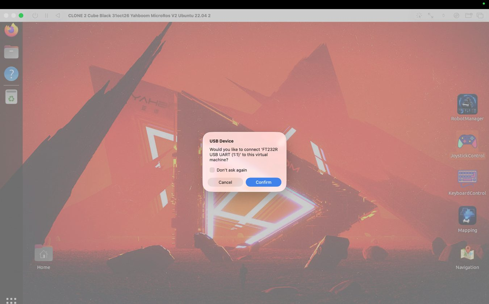

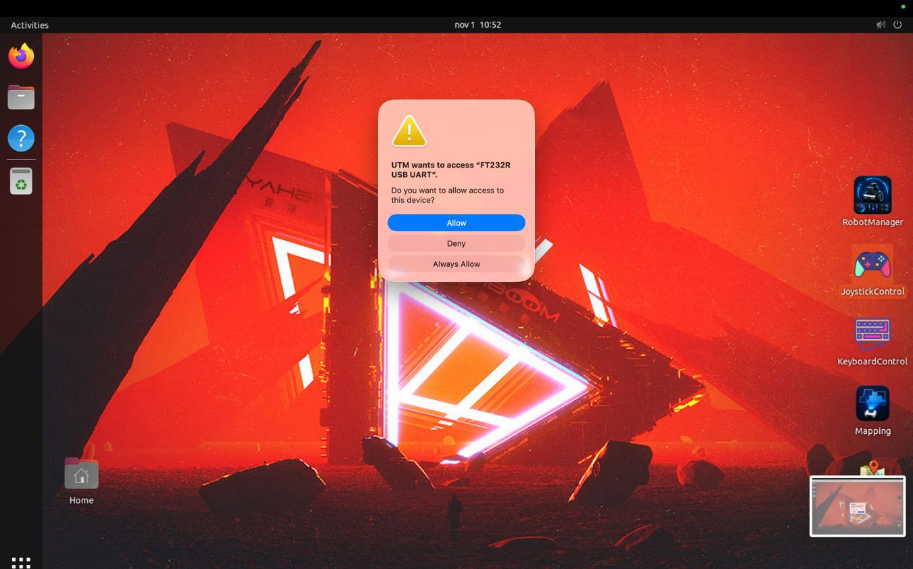

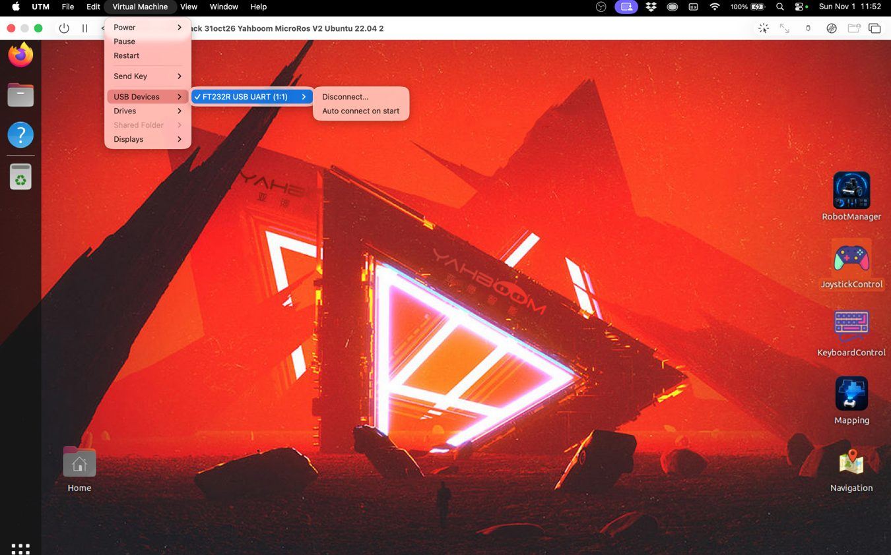

Verify in Ubuntu:

```bash
ls -l /dev/ttyUSB*
lsusb
```

The successful run used **`/dev/ttyUSB0`**. The number can change after reconnecting. If access is denied, check your `dialout` membership (`groups`) and relog rather than running all tools as root.

### Step 4 — Attach the joystick dongle to UTM

Connect the joystick receiver to the Mac. Approve the UTM USB forwarding prompt for **Controller**, and the macOS device-access prompt if shown.


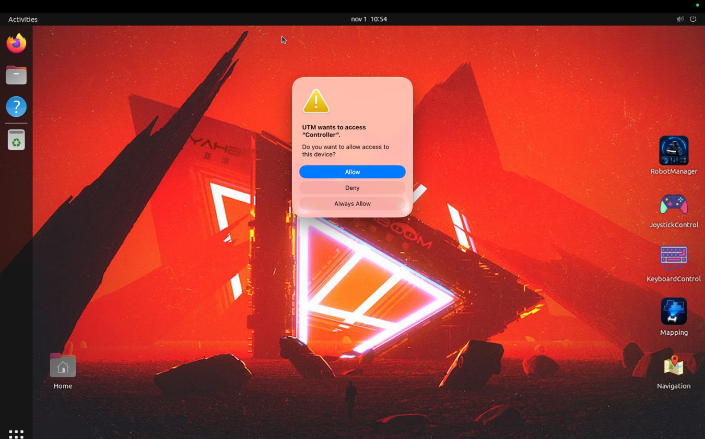

### Step 5 — Operate the GPS/safety-button assembly as used in the experiment

The operator reported holding a button on the GPS assembly for approximately **two seconds**. On Here2/CubePilot hardware, this may be the **safety switch** rather than a GPS acquisition button; confirm the actual button function/LED status for your unit. **Pressing it does not itself guarantee GPS fix**. Wait for a valid GPS position and EKF position estimate in the GCS. Do not disable arming checks to conceal a missing position estimate.

### Step 6 — Launch `JoystickControl` in Ubuntu

Double-click the desktop **JoystickControl** launcher. In the captured run, the terminal displayed:

```text
=== JoystickControl ARM64 ===
ROS_DOMAIN_ID=40
CAR_TYPE=ptz
...
[micro_ros_agent-1] ... port: 8090
[joy_node-2] ... Opened joystick: Controller
[joy_control_node-3] ... started
```

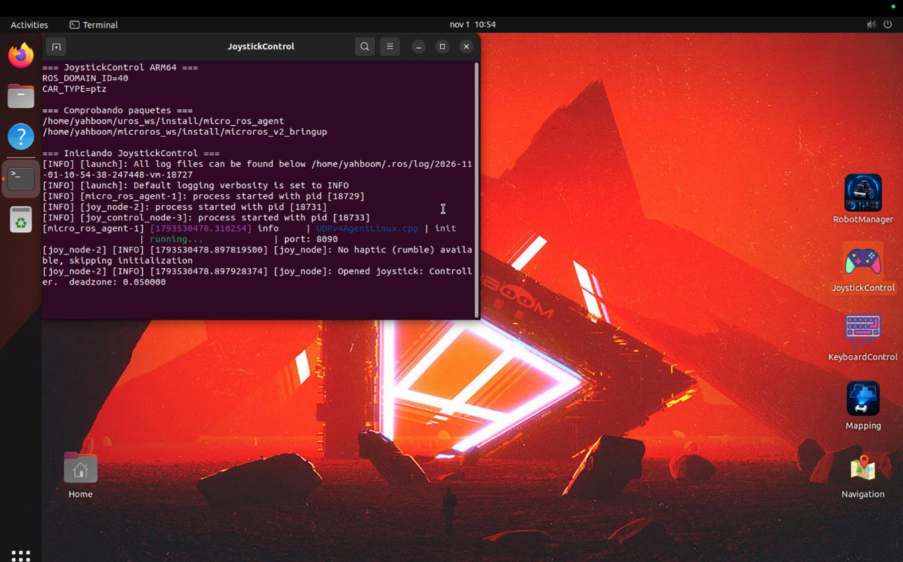

**Important:** this launcher starts the micro-ROS agent **and** the `joy_control` publisher on `/cmd_vel`. During autonomous navigation the separate MAVLink bridge also publishes to `/cmd_vel`. **Do not allow both to command the motors simultaneously.** After the agent has started, stop only the joy-control and joystick reader subprocesses, not the micro-ROS agent. Identify exact PIDs first:

```bash
ps aux | grep -E 'joy_control_node|/joy_node|micro_ros_agent'
```

Then send `TERM` **only to the identified joy-control and joy-node PIDs** (not to the entire `ros2 launch` group); check that the launcher does not automatically respawn them. An alternative is to launch the agent standalone using the command in Step 7. Before starting the MAVLink bridge:

```bash
ros2 topic info /cmd_vel -v
```

Expected: **0 publishers, 1 subscriber**, `micro_ros_task_node` as the subscriber. If the subscriber is missing, check Wi-Fi/agent connection and `ROS_DOMAIN_ID`.

### Step 7 — Alternative: start only the micro-ROS agent (if not already running)

Use this route instead of the JoystickControl launcher when you don't need the physical joystick:

```bash
export ROS_DOMAIN_ID=40
source /opt/ros/humble/setup.bash
source ~/uros_ws/install/setup.bash
ros2 run micro_ros_agent micro_ros_agent udp4 --port 8090 -v6
```

**Do not launch a second agent on port 8090 if JoystickControl has already started one.** Verify the robot subscription and battery telemetry:

```bash
ros2 topic info /cmd_vel -v
ros2 topic echo /battery --once
```

### Step 8 — Start MAVProxy with all three outputs

Open another Ubuntu terminal. The successful invocation was:

```bash
mavproxy.py \
  --master=/dev/ttyUSB0,57600 \
  --source-system=254 \
  --out=udp:192.168.1.57:14550 \
  --out=udp:127.0.0.1:14551 \
  --out=udp:127.0.0.1:14552
```

`192.168.1.57` was the **Mac's address on the test network**; substitute the Mac's current reachable IP if it changes. `14552` is **optional**, used only for the separate keyboard controller. Do not add an extra `c` to the end of the port number.

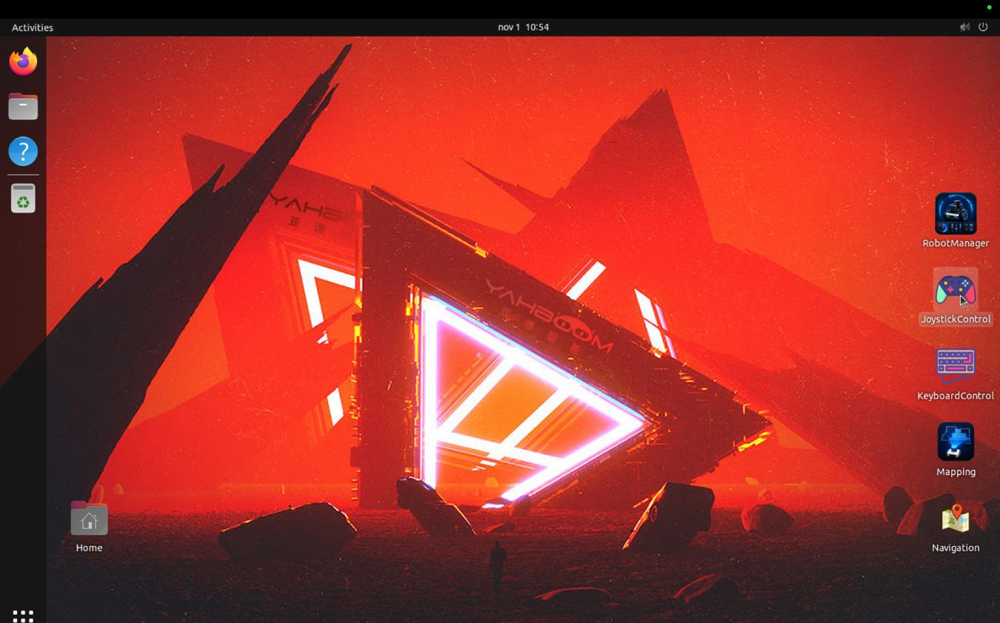

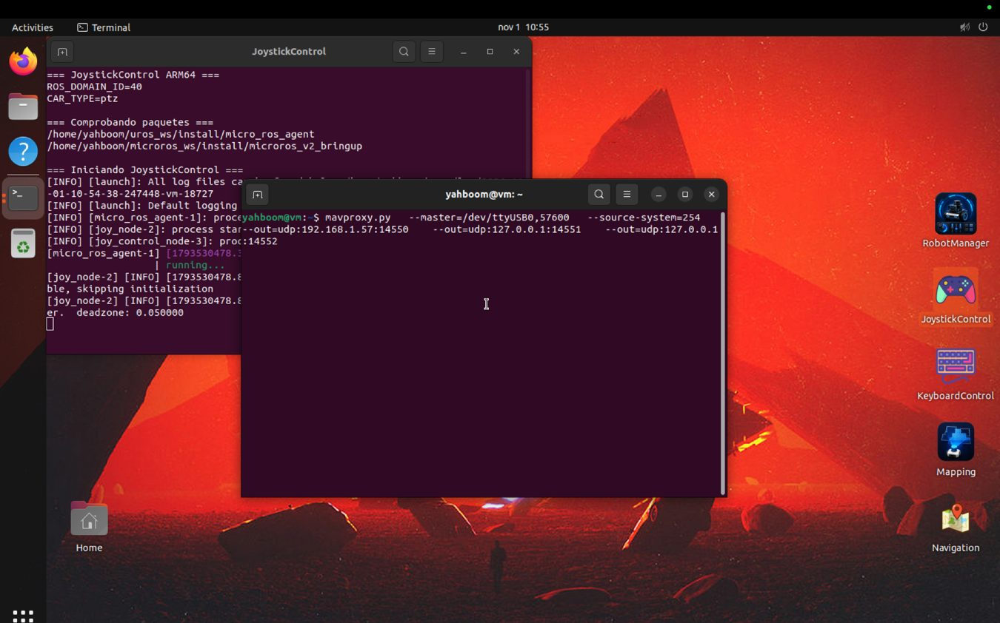

MAVProxy should detect vehicle `1:1`, identify its mode (typically HOLD when safe), and display telemetry such as GPS lock and firmware. Check `output` to verify three UDP destinations. `GPS lock at 19 meters` in one screenshot is **not a claim of RTK-centimeter accuracy**.

### Step 9 — Open ArduDeck on the Mac and connect via UDP

In **Connection → Single vehicle → UDP → Listen (Server)** set **Local Port `14550`**, protocol **MAVLink**, then click **Connect**. MAVProxy must already be forwarding to the Mac on this port.

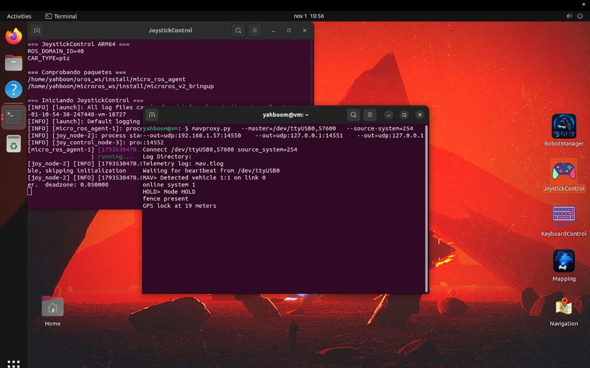

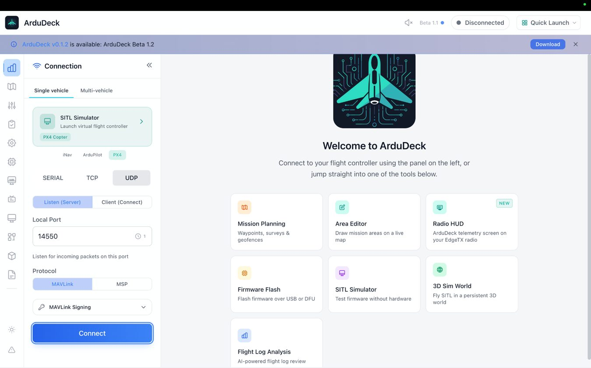

Check that the vehicle is recognized as a **Ground Rover**, its system ID is `1`, and that GPS has a valid 3D fix **and the EKF has a reliable position estimate**. A display of 3D Fix alone is not enough to prove position quality suitable for autonomous field driving.

**Optional:** The screenshots show an NTRIP connection using a correction mountpoint. This is separate from the minimum startup path and should be configured only if your GPS receiver and correction transport support it.

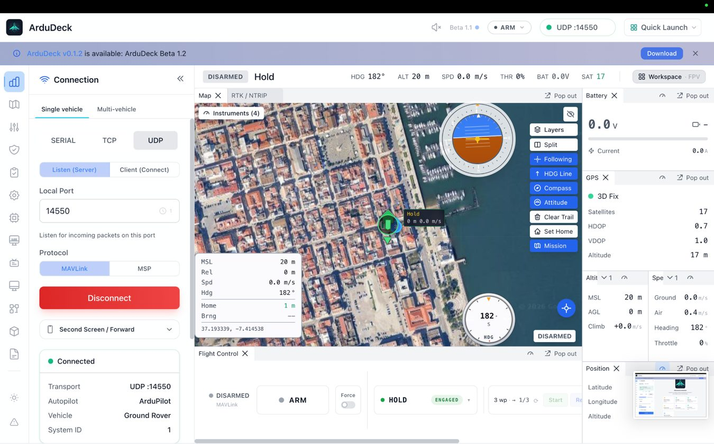

### Step 10 — Start the MAVLink-to-ROS 2 bridge

In a new Ubuntu terminal, ensuring no other node is publishing competing `/cmd_vel` movement commands:

```bash
export ROS_DOMAIN_ID=40
source /opt/ros/humble/setup.bash
python3 ~/mavlink_ros2_bridge_motion.py
```

**Critical AUTO modification**: the version used for this demonstration allowed `mode 10` as well as `mode 0`. Confirm that all safety conditions apply to *both* modes:

```python
MANUAL_MODE = 0
AUTO_MODE = 10

enabled = (
    self.armed
    and self.mode in (MANUAL_MODE, AUTO_MODE)
    and heartbeat_ok
    and servo_ok
    and within_test
)
```

Do **not** simply append `or self.mode == AUTO_MODE` outside the parentheses; that could bypass safety gates. The bridge's bench settings included `MAX_LINEAR=0.08`, `MAX_ANGULAR=0.30` and an expiration timer (`TEST_DURATION`); its initial versions used 30 s, then 180 s. **Check the actual currently installed code**, and restart only when disarmed if the timer has expired. This bridge reads channel outputs `SERVO1` and `SERVO3`, normalizes PWM about 1500 µs, and publishes ROS 2 `Twist` messages. A small velocity limit can make the rover very slow in AUTO even when ArduRover requests more speed.

### Step 11 — Upload the mission with ArduDeck

In ArduDeck's **Mission** planner, create or open the short test route. The recorded example had **3 waypoints**, approximately **17 m** planned length. Review every waypoint and make sure it lies in a *clear, physically accessible outdoor test area*; the captured example is a map/bench test and is **not** an approved route through public streets or buildings.

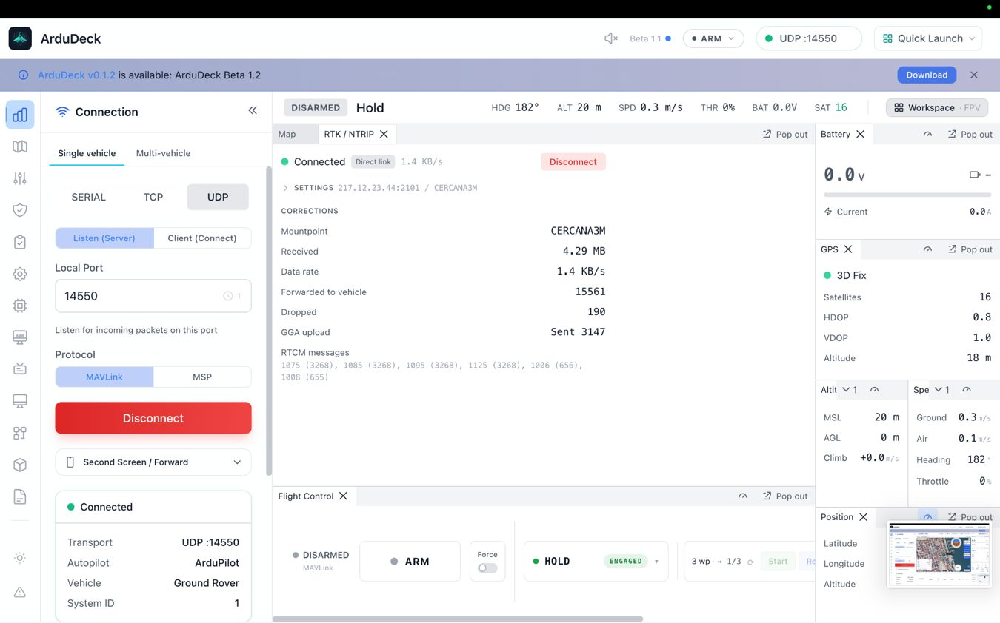

Use the upload icon, review the **Upload to vehicle** confirmation and click **Upload 3 WPs**. This replaces the existing mission on the controller.

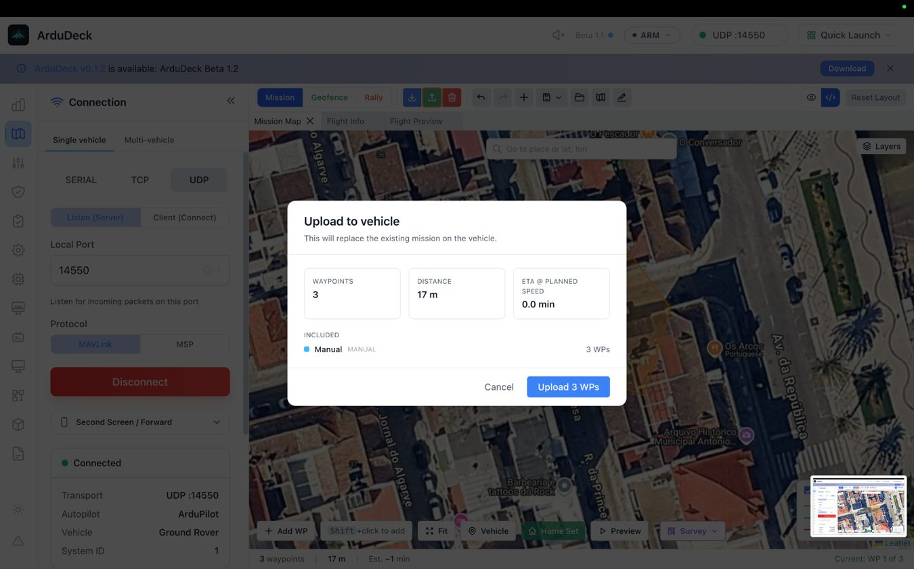

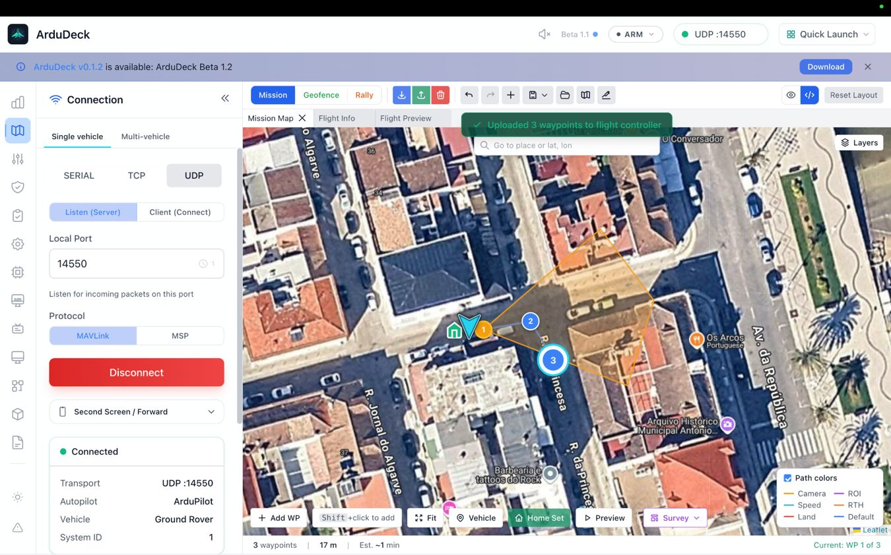

MAVProxy may report:

```text
Got MISSION_ACK: TYPE_MISSION: ACCEPTED
AP: Flight plan received
```

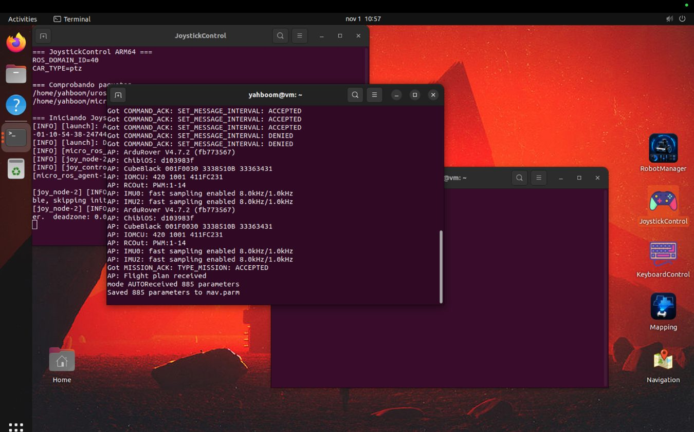

Confirm the waypoint count/sequence in the GCS. The mission `WP 1 of 3` and current-sequence indicators are not evidence that the robot physically reached any waypoint.

### Step 12 — Select AUTO, verify position, and arm (bench only)

**Correction to the original checklist:** `MANUAL` does **not** execute a mission; select **AUTO** to navigate waypoints. `MANUAL` is appropriate for direct steering/throttle and testing or manual intervention.

Start with **HOLD and disarmed**. With motor-power cutoff accessible, the chassis supported, and no hazardous tool installed, select **AUTO** in ArduDeck (or `mode AUTO` in MAVProxy). Confirm the mode change is accepted:

```text
mode AUTO
```

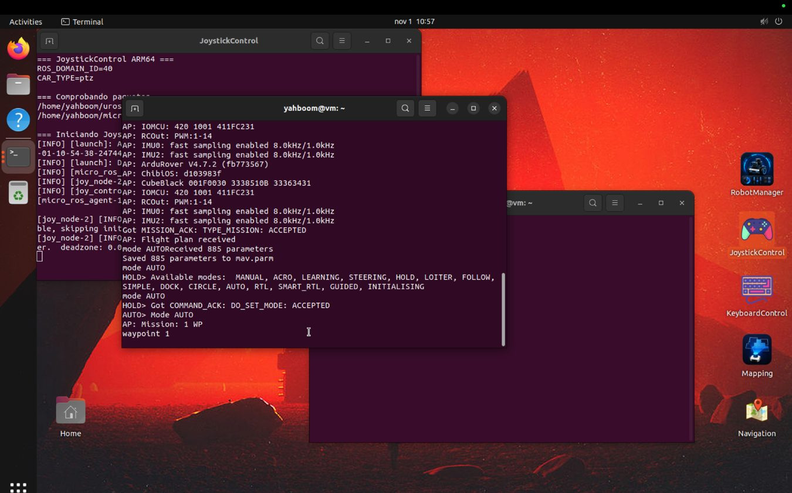

Previous logs showed an initial `Arm: Need Position Estimate`, then initialization of EKF3 with GPS before arming was accepted. **Do not arm if position is not reliable.** The recorded test used `ARMING_SKIPCHK=1048062` to bypass many pre-arm checks; that is a lab record, **not a recommended setup**. Restore/check protections for any ground-driving test.

Only after the system is safe for the specific bench test, command arming from the GCS or use MAVProxy `arm throttle`. The bridge should report `ARM=True MODE=10` together with `HB_OK=True`, `SERVO_OK=True`, `TIME_OK=True`, and `ENABLED=True` while its configured test window remains active.

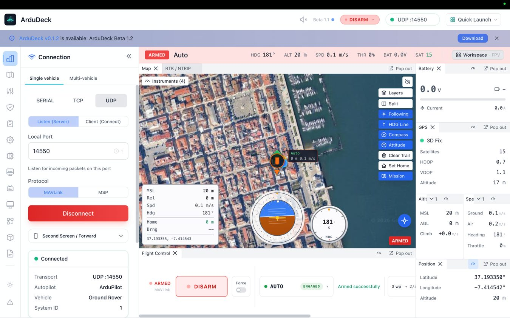

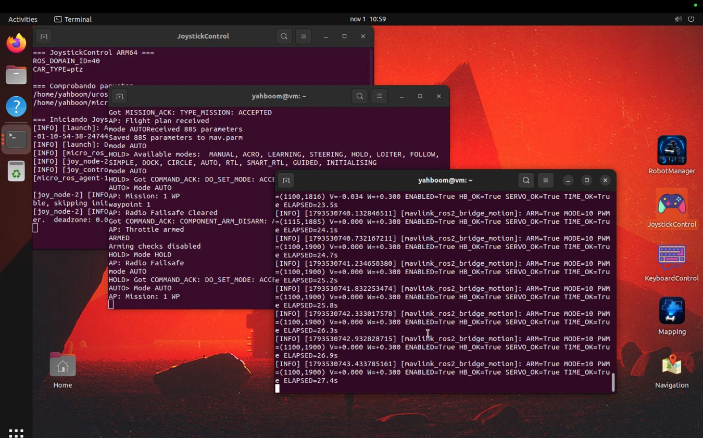

### Step 13 — Observe waypoint progress; stop safely

ArduDeck displays the active waypoint and the rover state. In the captured run the mission indicator advanced to **WP 2 of 3**, while the bridge printed non-neutral PWM left/right values. Because the physical rover was being tested suspended, this does **not** demonstrate successful on-ground tracking or arrival; apparent GPS movement can include position drift.

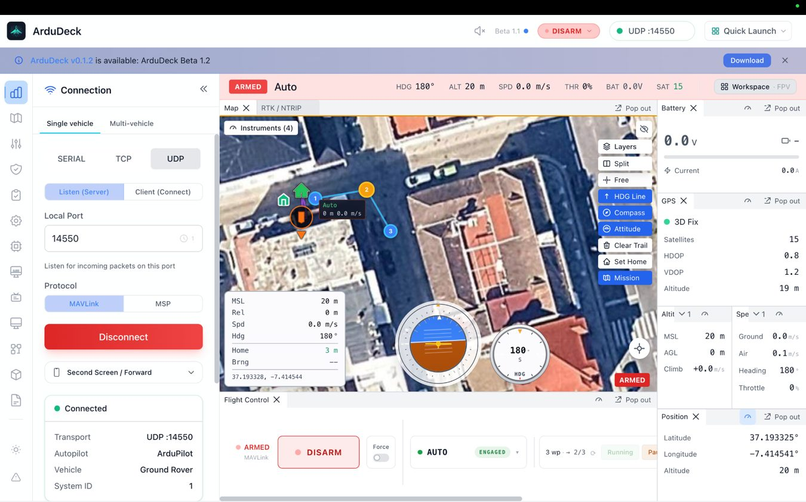

End the experiment by requesting **HOLD**, then **DISARM**, and verify the wheel motors stop. MAVProxy commands should be entered separately:

```text
mode HOLD
disarm
```

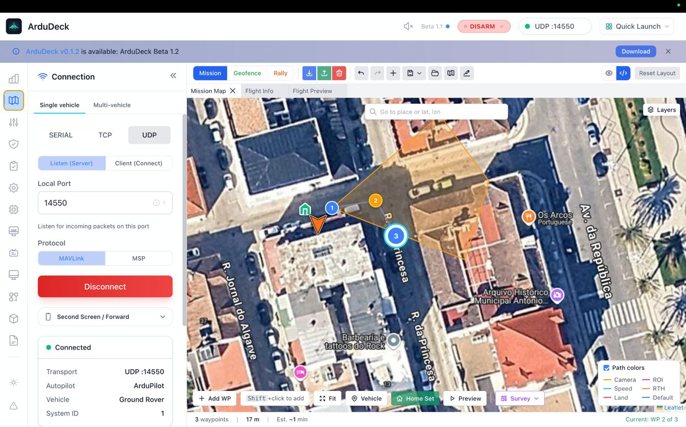

A `HOLD` command depends on both the MAVLink link and ROS/Wi-Fi/motor-controller path. If a wheel fails to stop, use a **physical cut-off of traction motor power**. A USB gamepad or keyboard is not an independently certified emergency stop. When finished, release any manual RC overrides (`rc 1 0`, `rc 3 0`) and disarm before shutdown.

## 4. Fast verification checklist

```bash
# Ubuntu: network and ROS
export ROS_DOMAIN_ID=40
source /opt/ros/humble/setup.bash
ros2 node list
ros2 topic info /cmd_vel -v
ros2 topic echo /battery --once

# Verify radio USB device
ls -l /dev/ttyUSB*

# Bridge publication, while bridge is running
ros2 topic hz /cmd_vel
ros2 topic echo /cmd_vel --once
```

Typical observations from the preceding working experiment: one `micro_ros_task_node` subscriber on `/cmd_vel`; bridge publication near **10 Hz**; Cube Black heartbeat and servo telemetry received over RFD868x; non-neutral PWM and `MODE=10` in AUTO. Telemetry observations alone do not prove physical GPS route completion.

## 5. Troubleshooting at a glance

| Symptom | Likely cause / check |
|---|---|
| `/dev/ttyUSB0` missing | Reattach FT232R in UTM USB Devices; check `lsusb` and the assigned tty |
| MAVProxy stuck waiting for heartbeat | Check both RFD868x radios, antennas, baud 57600, vehicle power and serial permissions |
| `/cmd_vel` subscriber absent | Wrong agent IP/port, ROS domain mismatch, Wi-Fi lost, or agent stopped |
| Two `/cmd_vel` publishers | `JoystickControl` joy-control node and custom bridge both active; stop joystick publisher without stopping agent |
| Keyboard cannot see heartbeat | MAVProxy is missing output `127.0.0.1:14552` or the separate tool is not listening |
| `ENABLED=False` in bridge | Inspect `ARM`, `MODE`, `HB_OK`, `SERVO_OK`, `TIME_OK` and elapsed test duration |
| Mode changes from AUTO to RTL | Inspect fence and radio/GCS failsafes; previously a polygon fence breach caused RTL |
| AUTO refuses to arm | EKF position estimate or other pre-arm fault; restore and diagnose checks instead of bypassing them |
| Wheels move very slowly | Bridge `MAX_LINEAR` may be 0.08 m/s; also check `WP_SPEED`, `CRUISE_SPEED`, `CRUISE_THROTTLE`, `MOT_SLEWRATE` |
| Mission progresses in GCS without physical travel | GPS drift / stationary bench test; only a supervised outdoor trial can verify waypoint arrival |

## 6. Before the first real outdoor route

The captured trial is **not** proof that the rover is safe to operate autonomously outdoors. Verify a **local motor stop/watchdog inside the Yahboom controller**, independent power-cutoff emergency stop, reliable manual takeover from AUTO, sensible travel speed and braking distances, functioning battery monitoring (ArduDeck showed Pixhawk battery 0.0 V), current GPS/RTK estimate, restored validated arming checks and a **new geofence for the actual test area**. Use an enclosed, obstacle-free site with a person ready to stop the machine. Keep any cutting equipment physically disconnected. Only then test a short, low-speed mission and compare `/odom_raw` with GPS and waypoint completion.

**Future work:** connect the existing LiDAR ROS 2 `/scan` data to ArduPilot proximity/obstacle avoidance, then test obstacle detection and controlled stopping before any path replanning.

## 7. Related project documentation

- `Pixhawk_Yahboom_MicroROS_No_RaspberryPi_README.md` — original wireless manual integration and scripts.
- `MISSION_AUTO_LIDAR_NEXT_STEPS.md` — detailed AUTO-mode addendum, source code, parameter inventory, velocity notes and LiDAR plan.

*All images are screenshots provided by the experimenter on 1 November 2026. Image filenames and relative links are retained in the accompanying ZIP so the guide renders on GitHub.*
